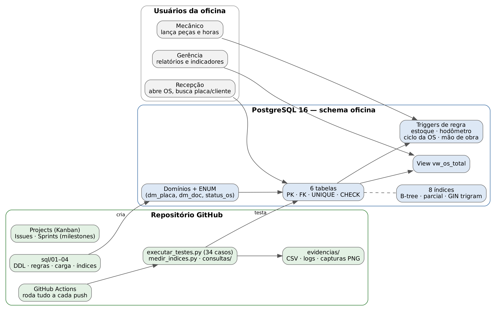
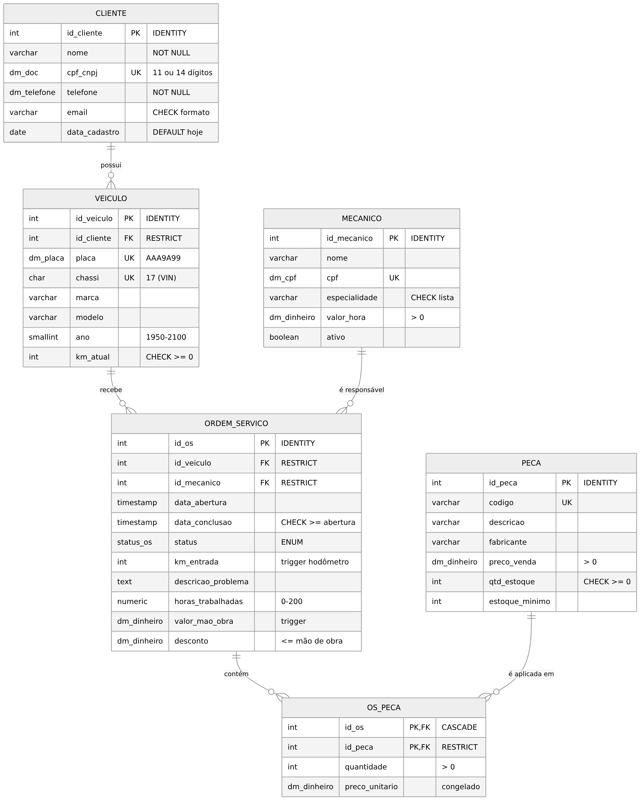

# Oficina Mecânica — Projeto de Banco de Dados (Tema 07)


Banco de dados em **PostgreSQL 16** para controlar **ordens de serviço (OS)** de uma oficina mecânica: clientes, veículos, mecânicos responsáveis, peças aplicadas e baixa de estoque. Cada regra afirmada no artigo tem um **teste executado** e uma **evidência** (captura de tela ou CSV) neste repositório.

## Equipe

- Jarlisson Brito Santos
- Brunno Passos
- Caio Vinicius

## O problema

Na oficina, o controle em papel e planilha gera falhas recorrentes:

| Problema | Consequência | Como o banco resolve | Teste |
|---|---|---|---|
| Mesma placa ou CPF cadastrado duas vezes | histórico do veículo espalhado | `UNIQUE` + domínios de formato | R02, R03, T02, T10 |
| Peça usada sem baixa no estoque | falta de peça, estoque fictício | trigger de baixa/estorno + `CHECK (qtd_estoque >= 0)` | G01, G02, G08 |
| OS sem mecânico responsável | ninguém responde por retrabalho | `id_mecanico NOT NULL` + FK + trigger "mecânico ativo" | G05 |
| Hodômetro "voltando" | fraude ou erro de digitação | trigger compara com `km_atual` | G06 |
| OS fechada sendo alterada | divergência no faturamento | `CHECK`s de data/status + trigger de ciclo de vida | R07–R09, G04, G07 |
| Busca do histórico por placa lenta | fila no balcão | índice `(id_veiculo, data_abertura DESC)` | B1: 30,6 ms → 0,25 ms |

## Arquitetura



### Modelo (DER)



## Estrutura do repositório

```
sql/
  01_ddl.sql              tabelas, domínios, ENUM, PK/FK/UNIQUE/CHECK
  02_regras_triggers.sql  5 regras de negócio em triggers + view vw_os_total
  03_carga_dados.sql      20 mil clientes, 30 mil veículos, 300 mil OS, ~450 mil itens
  04_indices.sql          8 índices, cada um ligado a uma consulta
testes/                   34 casos (gerados por scripts/testes_spec.py)
consultas/                C01–C08: relatórios de negócio
scripts/
  rodar_tudo.sh           recria tudo e gera as evidências
  executar_testes.py      roda os 34 testes em BEGIN…ROLLBACK
  medir_indices.py        EXPLAIN ANALYZE antes/depois (mediana de 7 execuções)
  comparar_views.py       view GROUP BY x LATERAL
  executar_consultas.py   roda C01–C08
  criar_quadro_github.sh  cria issues, sprints e o quadro Kanban
evidencias/
  resultados/             CSV, logs .txt e planos de execução
  capturas/               PNG das saídas reais do psql
docs/                     metodologia ágil e diagramas
artigo/                   artigo no modelo SBC (.tex, .pdf, .docx)
```

## Como executar

```bash
createdb oficina
./scripts/rodar_tudo.sh          # ~1 min: cria, carrega, testa, mede e captura
```

Requisitos: PostgreSQL 16 (`psql`), Python 3 e Pillow (`pip install pillow`). A conexão usa as variáveis do libpq (`PGHOST`, `PGUSER`, `PGPASSWORD`, `PGDATABASE`). O GitHub Actions executa exatamente esse script a cada push.

## Resultados

### Testes de tipos, restrições e regras: 34/34 passaram

Resumo completo em [`evidencias/resultados/resumo_testes.md`](evidencias/resultados/resumo_testes.md). Cada teste tem log em `.txt` e captura em `.png`.

### Índices (mediana de 7 execuções, 300 mil OS)

| Consulta | Índice | Antes | Depois | Páginas lidas |
|---|---|---:|---:|---|
| B1 Histórico por placa | `ix_os_veiculo_data` | 30,60 ms | 0,25 ms | 8.323 → 31 |
| B2 Painel de OS pendentes | `ix_os_pendentes` (parcial) | 24,80 ms | 0,35 ms | 8.276 → 52 |
| B3 Produção do mecânico/mês | `ix_os_mecanico_data` | 24,32 ms | 0,84 ms | 8.204 → 200 |
| B4 Faturamento do mês | `ix_os_conclusao` | 23,52 ms | 6,28 ms | 8.204 → 2.590 |
| B5 Consumo de uma peça | `ix_os_peca_peca` | 29,25 ms | 2,56 ms | 2.870 → 611 |
| B6 Veículos do cliente | `ix_veiculo_cliente` | 2,00 ms | 0,14 ms | 613 → 4 |
| B7 Cliente por parte do nome | `ix_cliente_nome_trgm` (GIN) | 12,04 ms | 0,97 ms | 266 → 174 |
| B8 OS CONCLUIDAS (95%) | `ix_os_status` | 46,32 ms | 49,09 ms | **índice ignorado** (Seq Scan) |
| B9 OS ABERTAS (0,2%) | `ix_os_status` | 25,46 ms | 1,59 ms | 8.204 → 532 |
| W1 INSERT de 20 mil OS | todos | 1.250 ms | 1.578 ms | custo de escrita: +26% |

Arquivo: [`evidencias/resultados/indices_antes_depois.csv`](evidencias/resultados/indices_antes_depois.csv). Os tempos variam entre execuções; o número de páginas lidas é a medida mais estável.

## Metodologia ágil

Scrum simplificado com 5 sprints semanais e quadro Kanban no GitHub Projects. Veja [`docs/metodologia_agil.md`](docs/metodologia_agil.md).

**Apresentação:** 30/11/2026, 10 minutos por grupo (15h10–18h30).
